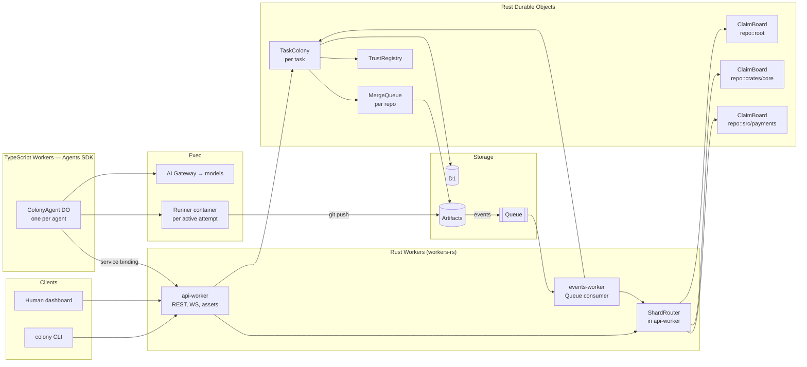

# PLAN.md — Colony: a Git platform for agent swarms

> Working name: **Colony**. A Git platform where hundreds of AI agents work on one codebase at the same time, coordinating the way ant colonies and human households do: through shared signals in the environment, parallel attempts with evidence-based selection, and a clear escalation path to humans.
>
> Target: Cloudflare "Build the next Git platform" competition. Submission deadline **Wednesday, October 14, 2026**.
>
> Stack (hybrid):
> - **Colony core in Rust** (`workers-rs`): claims, sharding, decay, scoring, quorum, trust, merge queue.
> - **Agent brains in TypeScript** with the **Cloudflare Agents SDK** (`agents`), one Agent per worker-agent.
> - Shared logic compiled once: `colony-core` → native (tests, runner) and Wasm (imported by TS agents).
> - Platform: Artifacts, Durable Objects, Queues, D1, Containers, AI Gateway, Workers AI.

**Changelog**
- v2 (Oct 2): hybrid Agents SDK layer; Claim Board sharding by directory patterns (`src/*`, `crates/*`); batched heartbeats over hibernating WebSockets; AI Gateway for all model calls; sharded merge queue with merge trains; scaling targets and load test plan.
- v1 (Oct 2): initial all-Rust plan.

---

## 1. Goals and non-goals

### Competition requirements (must have)
- Multiple agents working on changes **concurrently** on the same codebase.
- Not "GitHub plus agents": coordination, review and merging are rethought.
- 5–10 minute demo video, open-source code (Apache-2.0 or MIT), run instructions.

### Product goals
1. **No central scheduler.** Agents self-select work from a shared board, like ants responding to colony needs.
2. **Conflicts avoided first, resolved second.** Intent claims make planned work visible before code collides.
3. **Parallel exploration, evidence-based selection.** For uncertain tasks, several agents attempt the same change in isolated forks; tests and reviewer quorum choose the winner.
4. **Every change explains itself.** A why-ledger records intent, alternatives and evidence for each merge.
5. **Humans govern, agents execute.** Trust is earned, risky paths need human sign-off, circuit breakers stop runaway loops.
6. **Scales to hundreds of agents.** No single hot object on the coordination path; cost grows with work done, not with idle agents.

### Scale targets
| Metric | Demo (live) | Load test (simulated) | Design ceiling (v1 architecture) |
|---|---|---|---|
| Concurrent agents | 50–100 | 300 | ~1,000 per repo |
| Active claims | ~150 | ~1,000 | ~5,000 |
| Claim ops/s (all shards) | < 10 | ~50 | ~1,000+ (scales with shard count) |
| Merges to `main` per hour | ~20 | ~150 | limited by test time, not platform |

### Non-goals (for the competition build)
- Full GitHub feature parity (issues UI, wikis, org management, billing).
- Multi-tenant production hardening. One account, one demo namespace.
- Training our own model.

---

## 2. Design principles: from colonies and households to software

| Real-world mechanism | Where it comes from | Colony feature |
|---|---|---|
| Stigmergy (coordinate through the environment) | Ant pheromone trails | Intent claims and events live on Claim Board shards, not in agent-to-agent chat |
| Local signals, no global map | Ant colonies | Claim Board is **sharded by directory**; each area keeps its own trails |
| Pheromone evaporation | Ants | Claims decay unless refreshed by heartbeats; crashed agents never block work |
| Response thresholds | Ant task allocation | Agents probabilistically pick tasks based on urgency vs. their specialty threshold |
| Parallel foraging + reinforcement | Ant shortest-path finding | N attempts per uncertain task in separate forks; best-scoring attempt wins |
| Quorum sensing | Rock ant nest selection | Merge requires k-of-n independent reviewer approvals |
| Ownership / territory | Households ("my room") | Path ownership rules; claims on owned paths need owner consent |
| Shared calendar | Families, teams | Claim Board shows who plans to touch what, and when |
| Promises released early | Social norms | Agents must release claims they can't finish |
| Escalation ladder | Families → elders → courts | avoid → detect → negotiate → arbiter agent → human |
| Earned autonomy | Probation at work | Trust tiers gate which tasks and paths an agent may take |
| Apology and repair | Human relationships | Revert + ledger note + trust penalty |
| Collective memory | Family stories, meeting minutes | Why-ledger with intent, alternatives, evidence |
| Death-spiral risk | Army ant mills | Circuit breakers: churn limits, loop detection, budgets, kill switch |

---

## 3. System architecture

### 3.1 Layer view

```
┌──────────────────────────────────────────────────────────────┐  ┌──────────────┐
│ Governance        trust tiers · protected paths · humans     │  │              │
├──────────────────────────────────────────────────────────────┤  │              │
│ Selection         evaluator · reviewer quorum · merge queue  │  │  Why-ledger  │
├──────────────────────────────────────────────────────────────┤  │   (D1)       │
│ Agent colony      ColonyAgent (Agents SDK) → runner container│  │              │
├──────────────────────────────────────────────────────────────┤  │ intent,      │
│ Signal layer      ShardRouter · ClaimBoard shards · events   │  │ alternatives,│
├──────────────────────────────────────────────────────────────┤  │ evidence     │
│ Environment       Artifacts: main repo + one fork / attempt  │  │              │
└──────────────────────────────────────────────────────────────┘  └──────────────┘
```

### 3.2 Component diagram



### 3.3 Components

| Component | Language / type | Responsibility |
|---|---|---|
| `api-worker` | Rust Worker | REST + WebSocket API, auth, dashboard assets, `ShardRouter`, routing to DOs |
| `ShardRouter` | Rust module (in `api-worker`) | Resolves paths and claim globs to Claim Board shards; fans out multi-shard claims |
| `events-worker` | Rust Worker, Queue consumer | Receives Artifacts events and routes them to `TaskColony`, shards and `MergeQueue` |
| `ClaimBoard` | Rust DO, **one per (repo, shard key)** | Live claims for one area; decay; overlap detection; churn tracking |
| `TaskColony` | Rust DO, one per task | Task state machine: forks, tokens, attempts, evaluation, quorum |
| `MergeQueue` | Rust DO, one per repo | Serializes landings on `main`; builds merge trains; bisects failures |
| `TrustRegistry` | Rust DO, singleton | Agent profiles, trust, tiers, budgets |
| `ColonyAgent` | TypeScript, Agents SDK (`Agent` class, a DO) | One per worker-agent: picks tasks, plans via LLM, drives its runner container, holds one hibernating WebSocket to the colony |
| Runner | Container (native Rust binary + git + toolchains) | Hands-on work: clone, edit files, run tests, push. Controlled by its `ColonyAgent` |
| D1 `colony` | Database | Tasks, attempts, reviews, ledger, metrics |
| AI Gateway | Gateway | All model calls: caching, rate limits, retries, provider fallback, per-agent cost logs |

### 3.4 Why hybrid (Rust core + Agents SDK)

- The Agents SDK is TypeScript-only. It gives each agent durable state, scheduling (`this.schedule`), callable methods, state sync to clients, MCP tooling and WebSocket hibernation, which we would otherwise rebuild.
- The colony's "laws" (claims, sharding, decay, scoring, quorum, trust, merge ordering) are where correctness matters most, and they live in Rust with property tests.
- `colony-core` compiles to Wasm and is imported by `ColonyAgent`, so threshold and scoring math is identical on both sides. No duplicated logic.
- The agent never edits code inside the Worker. It decides; the runner container acts.

**Fallback:** if the hybrid adds too much friction, `ColonyAgent` can be replaced by a Rust DO with alarms (the v1 design), with no changes to the Rust core.

---

## 4. Cloudflare services mapping

| Need | Service | Notes |
|---|---|---|
| Git hosting, forks, repo-scoped tokens | Artifacts | Binding: `create`, `get`, `fork`, `createToken`, `readFile`, `readTree`, `log`, `readCommit` |
| Change notifications | Artifacts event subscriptions → Queue | Push/fork events drive tasks, shards and merge queue |
| Agent runtime | Agents SDK (`agents` npm) | `ColonyAgent extends Agent` |
| Coordination state | Durable Objects (Rust) | Shards, tasks, merge queue, trust |
| Durable timers | DO alarms (Rust) / `this.schedule` (Agents) | Decay sweeps, deadlines, agent loops |
| Cross-language calls | Service bindings | `ColonyAgent` → `api-worker`, no public hop |
| Queryable history | D1 | Ledger, dashboards, metrics |
| Hands-on execution | Containers | One per active attempt; pooled and reused |
| Model access | AI Gateway (+ Workers AI) | Tiered models; caching; rate limits |
| Data residency | Artifacts jurisdiction | Optional EU namespace demo |
| Preview deploys of attempts | Workers Builds + Previews (optional) | Reviewers can hit a live URL |

---

## 5. Repository layout

```
colony/
├── Cargo.toml                 # [workspace]
├── package.json               # pnpm workspace for TS packages
├── PLAN.md  README.md  LICENSE (Apache-2.0)
├── crates/
│   ├── colony-core/           # pure Rust: models, shards, claims, decay, thresholds, scoring, trust, policy
│   ├── colony-core-wasm/      # wasm-bindgen exports of colony-core for TS (wasm-pack --target bundler)
│   ├── colony-artifacts/      # Artifacts binding interop + REST fallback behind RepoStore trait
│   ├── colony-api/            # api-worker + ShardRouter + DO classes
│   ├── colony-events/         # events-worker
│   ├── colony-runner/         # native binary for containers
│   └── colony-cli/            # native CLI
├── agents/
│   └── colony-agent/          # TypeScript Worker: ColonyAgent (Agents SDK)
│       ├── src/{index.ts, colony-agent.ts, runner.ts, models.ts}
│       └── wrangler.jsonc
├── packages/
│   └── colony-types/          # TS types generated from Rust (ts-rs) — single source of truth
├── dashboard/                 # static assets served by api-worker
├── migrations/                # D1 SQL
├── demo/{sample-app/, tasks.yaml, colony.toml}
├── loadtest/                  # simulated agents (no LLM)
└── containers/runner.Dockerfile
```

Types: Rust structs derive `ts_rs::TS`; `cargo test` exports them into `packages/colony-types`, so TS and Rust never drift.

---

## 6. Data model

### 6.1 Core types (`colony-core::model`)

```rust
pub type AgentId = String;
pub type TaskId = String;
pub type AttemptId = String;
pub type ShardKey = String;          // e.g. "src/payments", "crates/colony-core", "root"

#[derive(Serialize, Deserialize, Clone, Copy, PartialEq, Eq, TS)]
pub enum Role { Coder, Reviewer, Arbiter, Integrator }

#[derive(Serialize, Deserialize, Clone, TS)]
pub struct AgentProfile {
    pub id: AgentId,
    pub roles: Vec<Role>,
    pub specialties: Vec<String>,          // ["rust", "security", "frontend"]
    pub thresholds: HashMap<String, f32>,  // per specialty; low = eager
    pub trust: f32,                        // 0.0..=1.0
    pub tier: TrustTier,
    pub model_family: String,              // for reviewer independence
    pub budget_remaining: Budget,
}

#[derive(Serialize, Deserialize, Clone, Copy, PartialOrd, PartialEq, TS)]
pub enum TrustTier { Probation, Member, Senior }

#[derive(Serialize, Deserialize, Clone, TS)]
pub struct Task {
    pub id: TaskId,
    pub repo: String,
    pub title: String,
    pub intent: String,
    pub tags: Vec<String>,
    pub urgency: f32,
    pub uncertainty: Uncertainty,    // Low/Medium/High -> 1/2/3 attempts
    pub paths_hint: Vec<String>,
    pub state: TaskState,
    pub created_at: u64,
}

#[derive(Serialize, Deserialize, Clone, Copy, TS)]
pub enum Uncertainty { Low, Medium, High }

#[derive(Serialize, Deserialize, Clone, TS)]
pub enum TaskState {
    Open,
    Exploring { attempts: Vec<AttemptId> },
    Evaluating,
    InReview { candidate: AttemptId },
    Queued { candidate: AttemptId, train: Option<String> },
    Merged { commit: String },
    Escalated { reason: String },
    Abandoned { reason: String },
}

#[derive(Serialize, Deserialize, Clone, TS)]
pub struct Attempt {
    pub id: AttemptId,
    pub task_id: TaskId,
    pub agent_id: AgentId,
    pub fork_repo: String,           // "<main>--t<task>--a<n>"
    pub head_commit: Option<String>,
    pub evidence: Option<Evidence>,
    pub score: Option<f32>,
}

#[derive(Serialize, Deserialize, Clone, TS)]
pub struct Evidence {
    pub required_tests_passed: bool,
    pub tests_passed: u32,
    pub tests_total: u32,
    pub lines_changed: u32,
    pub files_changed: Vec<String>,
    pub bench_delta_pct: Option<f32>,
    pub agent_rationale: String,
}
```

### 6.2 Claims (`colony-core::claims`)

```rust
#[derive(Serialize, Deserialize, Clone, TS)]
pub struct Claim {
    pub id: String,
    pub agent_id: AgentId,
    pub task_id: TaskId,
    pub paths: Vec<String>,          // globs: "src/payments/**"
    pub shards: Vec<ShardKey>,       // resolved by ShardRouter at grant time
    pub shard_map_version: u32,
    pub intent: String,
    pub strength0: f32,              // from agent trust
    pub last_heartbeat_ms: u64,
    pub ttl_ms: u64,                 // hard cap, default 30 min
}

/// Pheromone-style decay: s(t) = s0 · exp(−λ · idle_minutes)
pub fn strength(c: &Claim, now_ms: u64, lambda_per_min: f32) -> f32 {
    let idle_min = now_ms.saturating_sub(c.last_heartbeat_ms) as f32 / 60_000.0;
    c.strength0 * (-lambda_per_min * idle_min).exp()
}

pub fn is_alive(c: &Claim, now_ms: u64, cfg: &ClaimCfg) -> bool {
    strength(c, now_ms, cfg.lambda_per_min) >= cfg.min_strength
        && now_ms < c.last_heartbeat_ms + c.ttl_ms
}
```

Defaults (tuned for scale): heartbeat every **90 s**, batched per agent (one message refreshes all its claims); λ = 0.2/min; min strength 0.2. With s0 = 1.0 a silent agent's claims evaporate after about 8 minutes, i.e. 5 missed heartbeats.

### 6.3 D1 schema (`migrations/0001_init.sql`)

```sql
CREATE TABLE tasks (
  id TEXT PRIMARY KEY, repo TEXT NOT NULL, title TEXT NOT NULL,
  intent TEXT NOT NULL, tags TEXT NOT NULL, urgency REAL NOT NULL,
  uncertainty TEXT NOT NULL, state TEXT NOT NULL,
  created_at INTEGER NOT NULL, updated_at INTEGER NOT NULL
);

CREATE TABLE attempts (
  id TEXT PRIMARY KEY, task_id TEXT NOT NULL REFERENCES tasks(id),
  agent_id TEXT NOT NULL, fork_repo TEXT NOT NULL,
  head_commit TEXT, evidence_json TEXT, score REAL,
  status TEXT NOT NULL, created_at INTEGER NOT NULL
);

CREATE TABLE reviews (
  id TEXT PRIMARY KEY, attempt_id TEXT NOT NULL REFERENCES attempts(id),
  reviewer_id TEXT NOT NULL, model_family TEXT NOT NULL,
  verdict TEXT NOT NULL, score REAL NOT NULL, notes TEXT,
  created_at INTEGER NOT NULL
);

CREATE TABLE ledger (
  id TEXT PRIMARY KEY, task_id TEXT NOT NULL, merged_commit TEXT NOT NULL,
  intent TEXT NOT NULL, winner_attempt TEXT NOT NULL,
  alternatives_json TEXT NOT NULL, evidence_json TEXT NOT NULL,
  reviewers_json TEXT NOT NULL, shards_json TEXT NOT NULL,
  train_id TEXT, revisit_when TEXT, created_at INTEGER NOT NULL
);

CREATE TABLE agent_events (
  id TEXT PRIMARY KEY, agent_id TEXT NOT NULL, kind TEXT NOT NULL,
  task_id TEXT, delta_trust REAL, created_at INTEGER NOT NULL
);

CREATE INDEX idx_attempts_task ON attempts(task_id);
CREATE INDEX idx_ledger_task ON ledger(task_id);
```

D1 writes happen on **state transitions only** (never per heartbeat), batched with `DB.batch()` where possible. The ledger is also committed into the repo as `.colony/ledger/<task-id>.md`.

---

## 7. Claim Board sharding

### 7.1 Why
A Durable Object is single-threaded, which makes it ideal for race-free claim checks but turns one-board-per-repo into a hotspot as agent counts grow. Sharding by directory spreads load across many objects, and it matches the colony model: local trails per area, no global map.

### 7.2 Configuration

Sharding is configured per repository in `colony.toml` at the repo root (read from the default branch with `readFile`). If the file is missing, or `enabled = false`, the repo uses a single shard named `root`, which is exactly the v1 behaviour.

```toml
# colony.toml
[claims]
heartbeat_secs = 90
lambda_per_min = 0.2
min_strength   = 0.2
ttl_mins       = 30

[claims.sharding]
enabled       = true
# Order does not matter; longest prefix wins.
#  "dir/*"  -> each direct child directory of dir is its own shard
#  "dir"    -> the whole dir is one shard
shards        = ["src/*", "crates/*", "docs"]
default_shard = "root"          # everything not matched above
max_fanout    = 8               # a claim may touch at most 8 shards
broad_claim_tier = "Senior"     # who may exceed max_fanout (repo-wide refactors)
```

### 7.3 Shard key resolution rules

1. Patterns are either `prefix/*` (**children**) or `prefix` (**whole**). Wildcards elsewhere, `**`, or a leading `/` are rejected at config load.
2. Patterns are tried **longest prefix first**.
3. For a children pattern `src/*`:
   - `src/<child>/...` → shard `src/<child>`
   - a file directly in `src/` (e.g. `src/main.rs`) → shard `src` (the parent shard)
4. For a whole pattern `docs`: anything under `docs/` → shard `docs`.
5. No match → `default_shard` (`root`).
6. DO instance name: `"{repo}::{shard_key}"`, via `idFromName`. Disabled sharding → `"{repo}::root"`.

| Path | Shard |
|---|---|
| `src/payments/refund.rs` | `src/payments` |
| `src/api/routes/v2.rs` | `src/api` |
| `src/main.rs` | `src` |
| `crates/colony-core/src/lib.rs` | `crates/colony-core` |
| `docs/guide/intro.md` | `docs` |
| `README.md`, `Cargo.toml`, `.github/ci.yml` | `root` |

### 7.4 Resolution code (`colony-core::shards`)

```rust
#[derive(Clone, Debug, PartialEq, Eq)]
pub enum ShardPattern {
    Children(String), // "src/*" -> "src"
    Whole(String),    // "docs"  -> "docs"
}

impl ShardPattern {
    pub fn parse(s: &str) -> Result<Self, ShardError> {
        let s = s.trim().trim_end_matches('/');
        if s.is_empty() || s.starts_with('/') { return Err(ShardError::Invalid(s.into())); }
        if let Some(prefix) = s.strip_suffix("/*") {
            if prefix.contains('*') { return Err(ShardError::Invalid(s.into())); }
            return Ok(Self::Children(prefix.into()));
        }
        if s.contains('*') { return Err(ShardError::Invalid(s.into())); }
        Ok(Self::Whole(s.into()))
    }
    fn prefix(&self) -> &str { match self { Self::Children(p) | Self::Whole(p) => p } }
}

pub struct ShardMap {
    pub enabled: bool,
    pub version: u32,
    pub default_shard: String,
    patterns: Vec<ShardPattern>, // sorted by prefix length, descending
}

fn under<'a>(path: &'a str, prefix: &str) -> Option<&'a str> {
    path.strip_prefix(prefix)?.strip_prefix('/')
}

impl ShardMap {
    pub fn new(enabled: bool, version: u32, default_shard: &str, raw: &[String]) -> Result<Self, ShardError> {
        let mut patterns = raw.iter().map(|s| ShardPattern::parse(s)).collect::<Result<Vec<_>, _>>()?;
        patterns.sort_by(|a, b| b.prefix().len().cmp(&a.prefix().len()));
        Ok(Self { enabled, version, default_shard: default_shard.into(), patterns })
    }

    pub fn shard_for_path(&self, path: &str) -> String {
        if !self.enabled { return self.default_shard.clone(); }
        for p in &self.patterns {
            match p {
                ShardPattern::Children(prefix) => {
                    if let Some(rest) = under(path, prefix) {
                        return match rest.split_once('/') {
                            Some((child, _)) => format!("{prefix}/{child}"),
                            None => prefix.clone(), // file directly in prefix/
                        };
                    }
                }
                ShardPattern::Whole(prefix) => {
                    if under(path, prefix).is_some() { return prefix.clone(); }
                }
            }
        }
        self.default_shard.clone()
    }
}
```

### 7.5 Claim globs that span shards

A claim's globs are mapped to shards **conservatively** (may include extra shards, never misses one):

1. Take the glob's literal prefix: the path segments before the first segment containing `*`, `?` or `[`.
2. If that literal prefix fully determines a shard (e.g. `src/payments/**` → `src/payments`), the claim goes to that one shard.
3. Otherwise, the claim goes to every **known** shard whose key starts with the literal prefix, plus the parent shard, plus `root` if the glob could match unmatched paths. Examples:

| Claim glob | Shards |
|---|---|
| `src/payments/**` | `src/payments` |
| `src/payments/*.rs`, `src/api/**` | `src/payments`, `src/api` |
| `src/**/*.rs` | `src`, `src/api`, `src/payments`, … (all `src/*`) |
| `**/*.toml` | every shard → **broad claim** |

Known shards come from a `ShardIndex` kept in the `ShardRouter`: the list of directories matching each children pattern, built with `readTree` on the default branch and refreshed whenever `events-worker` sees a push to `main` that adds or removes a top-level child directory.

### 7.6 Multi-shard claims (atomic across shards)

Claims touching several shards use a short two-phase protocol driven by `ShardRouter`:

1. **Reserve** in every shard, in **sorted shard-key order** (deterministic order prevents deadlock between two routers). Each shard checks overlaps and holds a reservation with a 10 s timeout.
2. If all shards return `Granted` or `Shared` → **commit** in all. If any returns `Contended` → **abort** in all already reserved, and return the contention details so the conflict ladder can start.
3. A reservation that is never committed expires on its own (it is just a very short-lived claim), so a crashed router cannot leave locks behind.

Fan-out above `max_fanout` is a **broad claim**: only agents at `broad_claim_tier` may request it, it requires a human or arbiter OK, and it is the one case where the colony intentionally slows down (like a whole-house renovation that needs the family's agreement).

### 7.7 Re-sharding

Changing `colony.toml` on `main` bumps `shard_map_version`. The router then:
- sends **new** claims to the new map,
- leaves existing claims in their old shards until they decay or are released (old shards accept heartbeats and releases, not new claims),
- treats an old-version claim as overlapping with a new-version claim if their globs intersect (checked by the router during the transition window, which lasts at most one TTL).

No data migration needed: claims are short-lived by design.

### 7.8 Per-shard churn tracking
Each shard counts recent landings on its paths. The churn circuit breaker (§8.7) therefore freezes only the hot area (e.g. `src/payments`), not the whole repo.

---

## 8. Core algorithms

### 8.1 Task selection: response thresholds

`ColonyAgent` evaluates open tasks using the Bonabeau response-threshold rule (from `colony-core-wasm`):

```
P(take) = s² / (s² + θ²)
```

- `s` = `urgency × age_boost × (1 − coverage)`; coverage = fraction of planned attempts already taken.
- `θ` = agent threshold for the task's best-matching specialty. Probation agents only see `Uncertainty::Low` tasks outside protected paths.

Taking a slot is atomic in `TaskColony` (`POST /tasks/:id/attempts`). To avoid a thundering herd of hundreds of agents polling, open tasks are **pushed** over each agent's colony WebSocket (§9.4) rather than polled.

### 8.2 Overlap detection (per shard)

Inside a shard: drop dead claims → glob-intersect → return `Granted`, `Shared { with }` (same task, expected for parallel attempts) or `Contended { with, holder_strength }`.

### 8.3 Selection: scoring parallel attempts

```
gate:   required_tests_passed && policy checks pass
score = 0.45 · test_ratio
      + 0.25 · mean_first_pass_review
      + 0.15 · (1 − normalized_diff_size)
      + 0.15 · perf_term
```

Nothing passes → task reopens with failure notes; escalates after 2 failed rounds.

### 8.4 Conflict resolution ladder

| Step | Trigger | Action |
|---|---|---|
| 1. Avoid | Claim on owned/protected path | Owner or human consent first |
| 2. Detect | `Contended` claim (any shard) | Both agents get each other's intent |
| 3. Negotiate | Both still want the paths | Lower-strength claimant yields, or paths split; one round |
| 4. Rebase | Git conflict in merge queue | Integrator rebases; reruns tests |
| 5. Arbiter | Rebase fails / tests regress | Senior arbiter (different model family) proposes a resolution attempt |
| 6. Human | Arbiter fails, protected path, broad claim, breaker | `Escalated`; dashboard decision |
| Repair | Post-merge regression | Auto-revert, ledger note, trust penalty |

### 8.5 Quorum

k-of-n approvals (default 2 of 3); reviewers ≠ author; ≥ 1 reviewer of a different model family; security-tagged reject forces escalation; 10-minute timeout escalates.

**Review cost control at scale:** first-pass review uses a cheap model on every attempt; full quorum only on the selected candidate. A 3-attempt task therefore costs 3 cheap reviews + 3 quorum reviews, not 9 full reviews.

### 8.6 Trust

```
trust = (merged + 1) / (merged + rejected + 3·reverted + 2)
```
Tiers: Probation < 0.55 ≤ Member < 0.8 ≤ Senior (Senior also needs ≥ 10 merges).

### 8.7 Circuit breakers (anti-death-spiral)

- **Churn limit (per shard):** > 4 landings in 30 min freezes new claims in that shard.
- **Ping-pong detection:** same hunk reverted and reapplied twice → escalate.
- **Budgets:** per task (attempts, tokens, wall-clock), per agent per hour, and a **colony-wide token budget per hour** enforced via AI Gateway rate limits.
- **Admission control:** `ShardRouter` returns `429 Retry-After` with jitter when a shard is over its op budget; agents back off exponentially.
- **Global kill switch:** `POST /admin/pause`.

### 8.8 Merge queue and merge trains

Only one change can land on `main` at a time, so landing is serialized in a `MergeQueue` DO per repo. To keep throughput high with hundreds of agents:

1. Approved candidates enter the queue with their shard set.
2. The queue forms a **train**: up to N (default 5) candidates with **disjoint shard sets**, stacked in order.
3. The integrator runner applies the train onto current `main` in one throwaway branch and runs the full test suite once.
4. Green → fast-forward `main` with all train commits; each gets its own ledger entry with `train_id`.
5. Red → bisect the train (split in halves, retest) to find the culprit; land the good part, return the culprit to `InReview` with the failure.
6. Candidates with overlapping shards never share a train; they land in successive trains, rebasing in between.

This turns "one test run per merge" into roughly "one test run per five merges" in the common case.

---

## 9. Implementation details

### 9.1 Artifacts binding from Rust (`colony-artifacts`)

`workers-rs` has no first-class Artifacts binding, so we bind the JS RPC object with `wasm-bindgen`. The binding returns a **disposable** repo capability (JS `using`); in Rust we release it with a `Drop` guard.

```rust
use js_sys::{Promise, Reflect};
use wasm_bindgen::{prelude::*, JsCast};
use wasm_bindgen_futures::JsFuture;

#[wasm_bindgen]
extern "C" {
    #[wasm_bindgen(extends = js_sys::Object)]
    pub type ArtifactsNs;
    #[wasm_bindgen(method, catch)]
    fn get(this: &ArtifactsNs, name: &str) -> Result<Promise, JsValue>;

    #[wasm_bindgen(extends = js_sys::Object)]
    pub type RepoHandle;
    #[wasm_bindgen(method, catch)]
    fn info(this: &RepoHandle) -> Result<Promise, JsValue>;
    #[wasm_bindgen(method, catch)]
    fn fork(this: &RepoHandle, name: &str, opts: &JsValue) -> Result<Promise, JsValue>;
    #[wasm_bindgen(method, catch, js_name = createToken)]
    fn create_token(this: &RepoHandle, scope: &str, ttl: u32) -> Result<Promise, JsValue>;
    #[wasm_bindgen(method, catch, js_name = readFile)]
    fn read_file(this: &RepoHandle, args: &JsValue) -> Result<Promise, JsValue>;
    #[wasm_bindgen(method, catch, js_name = readTree)]
    fn read_tree(this: &RepoHandle, hash: &str) -> Result<Promise, JsValue>;
}

/// Mirrors JS `using`: calls repo[Symbol.dispose]() on drop.
pub struct Repo(RepoHandle);

impl Drop for Repo {
    fn drop(&mut self) {
        let symbol_ctor = Reflect::get(&js_sys::global(), &"Symbol".into()).ok();
        let dispose = symbol_ctor.and_then(|s| Reflect::get(&s, &"dispose".into()).ok());
        if let Some(key) = dispose.filter(|k| !k.is_undefined()) {
            if let Ok(f) = Reflect::get(&self.0, &key) {
                if let Some(f) = f.dyn_ref::<js_sys::Function>() { let _ = f.call0(&self.0); }
            }
        }
    }
}

pub async fn open(ns: &ArtifactsNs, name: &str) -> Result<Repo, JsValue> {
    Ok(Repo(JsFuture::from(ns.get(name)?).await?.unchecked_into()))
}
```

All callers use the `RepoStore` trait; a REST implementation (`worker::Fetch` + API token secret) is the fallback if the spike fails. **Day-1 spike** confirms: raw binding reachable from `worker::Env`, RPC promises resolve from Wasm, dispose works, `Blob` → text conversion.

### 9.2 Event consumer (`colony-events`)

```rust
#[derive(Deserialize)]
struct ArtifactsEvent {
    #[serde(rename = "type")] kind: String,
    source: Source,
    payload: serde_json::Value,
}
#[derive(Deserialize)]
struct Source { namespace: String, #[serde(rename = "repoName")] repo_name: String }

#[event(queue)]
async fn main(batch: MessageBatch<ArtifactsEvent>, env: Env, _ctx: Context) -> Result<()> {
    for msg in batch.messages()? {
        let ev = msg.body();
        if ev.kind == "cf.artifacts.repo.pushed" {
            let r#ref = ev.payload["ref"].as_str().unwrap_or_default();
            let after = ev.payload["after"].as_str().unwrap_or_default();
            route_push(&env, &ev.source.repo_name, r#ref, after).await?; // idempotent on (repo, after)
        }
        msg.ack();
    }
    Ok(())
}
```

Routing: fork pushes (`<main>--t<task>--a<n>`) → `TaskColony`. Main pushes → `MergeQueue` (confirm landing), `ShardRouter` (churn per shard, `ShardIndex` refresh, `colony.toml` changes → re-shard).

### 9.3 Rust Durable Objects

- `ClaimBoard` (per `repo::shard`): storage `claims:<id>`, `reservations:<id>`. Alarm every 30 s while non-empty. Ops: reserve, commit, abort, heartbeat-batch, release, list.
- `TaskColony` (per task): state machine; alarms for exploration deadline and quorum timeout.
- `MergeQueue` (per repo): queue, active train, bisect state.
- `TrustRegistry`: agent profiles, tiers, budgets.

### 9.4 `ColonyAgent` (TypeScript, Agents SDK)

One Agent instance per worker-agent. It holds the agent's profile, current attempt and claim ids in Agent state, keeps **one hibernating WebSocket** to `api-worker` for pushed tasks and batched heartbeats, and drives its runner container.

```ts
import { Agent, callable } from "agents";
import { pickTask, type OpenTask } from "colony-core-wasm"; // same Rust logic, compiled to Wasm
import type { AgentProfile } from "colony-types";

type AgentState = {
  profile: AgentProfile;
  attemptId?: string;
  claimIds: string[];
  status: "idle" | "working" | "reviewing";
};

export class ColonyAgent extends Agent<Env, AgentState> {
  async onStart() {
    await this.schedule(90, "heartbeat");             // seconds; re-armed in heartbeat()
  }

  @callable()
  async onTasksOffered(tasks: OpenTask[]) {          // pushed by the colony over WS
    if (this.state.status !== "idle") return;
    const choice = pickTask(this.state.profile, tasks, Math.random());
    if (!choice) return;
    const slot = await this.env.COLONY.takeAttempt(choice.id, this.state.profile.id); // service binding RPC
    if (!slot) return;                                // someone else got it
    const claim = await this.env.COLONY.claim({
      agentId: this.state.profile.id, taskId: choice.id,
      paths: choice.pathsHint, intent: choice.intent,
    });
    this.setState({ ...this.state, attemptId: slot.attemptId, claimIds: claim.ids, status: "working" });
    await this.startRunner(slot);                     // container does clone/edit/test/push
  }

  async heartbeat() {
    if (this.state.claimIds.length) {
      await this.env.COLONY.heartbeatBatch(this.state.profile.id, this.state.claimIds);
    }
    await this.schedule(90, "heartbeat");
  }

  private async startRunner(slot: { attemptId: string; remote: string; token: string; instructions: string }) {
    // getContainer(this.env.RUNNER, slot.attemptId).fetch(...) — exact Containers API verified on Day 4
  }
}
```

LLM calls inside the agent (planning, reviewing) go through **AI Gateway** with a per-agent metadata tag for cost tracking. Model tiers: small model for first-pass review and task triage; strong model for coding and quorum; strongest for arbiter.

### 9.5 Runner (`colony-runner`, native Rust in a container)

Receives a job from its `ColonyAgent`: `{remote, token, instructions, plan}`. Steps: clone (shallow) → apply edits proposed by the agent (or run its own edit loop when given a model endpoint) → run tests → write `.colony/attempts/<id>.json` → push → report evidence. Roles share the binary: `--role coder|reviewer|integrator|arbiter`. Containers are **pooled per role** and reused across attempts to avoid cold starts; a pool manager caps concurrency (e.g. 100 coder containers live).

### 9.6 Key dependencies

Rust: `worker` (`d1`, `queue` features), `wasm-bindgen`, `wasm-bindgen-futures`, `js-sys`, `web-sys`, `serde`, `serde_json`, `globset`, `uuid` (`js`), `thiserror`, `ts-rs`, `toml`; runner: `tokio`, `reqwest`, `clap`, `git` CLI. TypeScript: `agents`, `wasm-pack` output of `colony-core-wasm`.

### 9.7 Config sketches

`crates/colony-api/wrangler.toml`
```toml
name = "colony-api"
main = "build/worker/shim.mjs"
compatibility_date = "2026-10-01"

[build]
command = "cargo install -q worker-build && worker-build --release"

[[artifacts]]
binding = "ARTIFACTS"
namespace = "colony-demo"

[[d1_databases]]
binding = "DB"
database_name = "colony"
database_id = "<id>"

[durable_objects]
bindings = [
  { name = "CLAIM_BOARD",    class_name = "ClaimBoard" },
  { name = "TASK_COLONY",    class_name = "TaskColony" },
  { name = "MERGE_QUEUE",    class_name = "MergeQueue" },
  { name = "TRUST_REGISTRY", class_name = "TrustRegistry" },
]

[[migrations]]
tag = "v1"
new_sqlite_classes = ["ClaimBoard", "TaskColony", "MergeQueue", "TrustRegistry"]

[assets]
directory = "../../dashboard"
```

`agents/colony-agent/wrangler.jsonc`
```jsonc
{
  "name": "colony-agent",
  "main": "src/index.ts",
  "compatibility_date": "2026-10-01",
  "durable_objects": { "bindings": [{ "name": "ColonyAgent", "class_name": "ColonyAgent" }] },
  "migrations": [{ "tag": "v1", "new_sqlite_classes": ["ColonyAgent"] }],
  "services": [{ "binding": "COLONY", "service": "colony-api" }]
  // + containers binding for RUNNER, AI Gateway / Workers AI bindings
}
```

---

## 10. API surface (v0)

| Method | Path | Purpose |
|---|---|---|
| POST | `/repos` | Create/import main repo; reads `colony.toml` |
| GET | `/repos/:repo/shards` | Shard map version, patterns, known shards, load per shard |
| GET | `/repos/:repo/board?shard=` | Live claims (one shard or merged view) |
| POST | `/tasks` | Create task |
| GET | `/tasks/:id` | Task, attempts, scores, reviews |
| POST | `/tasks/:id/attempts` | Atomically take a slot; returns fork remote + token |
| POST | `/claims` | Create claim (router resolves shards, runs 2-phase if needed) |
| POST | `/agents/:id/heartbeat` | **Batched** heartbeat for all of an agent's claims |
| DELETE | `/claims/:id` | Release |
| GET | `/ws/agents/:id` | Agent WebSocket: task offers, heartbeats, notifications |
| POST | `/attempts/:id/evidence` | Runner evidence |
| POST | `/reviews` | Reviewer verdict |
| GET | `/repos/:repo/merge-queue` | Queue, active train, bisect status |
| POST | `/tasks/:id/decide` | Human decision on escalation |
| GET | `/ledger?repo=&path=` | Why-ledger search |
| POST | `/admin/pause` · `/admin/resume` | Kill switch |

The same operations are exposed to `ColonyAgent` as **RPC methods on the service binding** (`takeAttempt`, `claim`, `heartbeatBatch`, …), avoiding HTTP parsing on the hot path.

Auth: per-agent keys hashed in `TrustRegistry`; dashboard behind Cloudflare Access; per-attempt repo tokens (1 h, write on own fork only); only the integrator writes `main`.

---

## 11. Dashboard (demo surface)

- **Claim Board heatmap:** file tree grouped by shard; claim strength drives opacity, so decay is visible. Per-shard load and churn badges.
- **Task lanes:** parallel attempts racing with live scores.
- **Quorum panel** and **merge queue/train view** (including bisect when a train fails).
- **Escalations inbox** for humans.
- **Ledger explorer:** click a line → intent, alternatives, evidence.
- **Scale panel:** live agent count, claim ops/s per shard, model spend/hour (from AI Gateway).

---

## 12. Scaling plan

### 12.1 Where load goes

| Hot path | Without care | Design |
|---|---|---|
| Heartbeats | 1 request per claim per minute | 1 batched message per agent per 90 s over a hibernating WS |
| Task discovery | Hundreds of agents polling | Server pushes offers to idle agents; jittered |
| Claim checks | One DO per repo | One DO per shard; 2-phase only for multi-shard claims |
| Merges | One test run per merge | Merge trains of disjoint shards; bisect on failure |
| LLM calls | Unbounded fan-out | AI Gateway rate limits, caching, tiered models, colony budget |
| D1 | Write per event | Write per state transition, batched |
| Containers | Cold start per attempt | Role-based warm pools, capped concurrency |

### 12.2 Rough numbers at 300 agents
- Heartbeats: 300 / 90 s ≈ 3.3 msg/s total, spread across shards.
- Claim ops (create/release/negotiate): ~1 per agent per 5 min ≈ 1 op/s.
- Even a single unsharded board would cope; sharding keeps headroom for 1,000+ agents and for dashboard reads.
- The real limits are **model rate limits and cost** and **test-suite time** in the merge queue, which is why §8.5 and §8.8 exist.

### 12.3 Load test (`loadtest/`)
- Simulated agents (no LLM): a Rust or k6 script that creates agents, takes tasks, claims random paths following a Zipf distribution (some hot directories), heartbeats, pushes scripted diffs to forks, and randomly dies.
- Scenarios: 300 agents for 20 min (sharded vs. unsharded); hot-shard storm on `src/payments`; mass agent death (50% killed) to verify decay; re-shard during load.
- Report: p50/p99 claim latency per shard, contention rate, merge throughput, decay correctness. Include the chart in the video.

---

## 13. Milestones (Oct 2 → Oct 14)

| Day | Date | Deliverable |
|---|---|---|
| 1 | Fri Oct 2 | Workspace scaffold (Cargo + pnpm); Artifacts interop spike; event subscription → Queue |
| 2 | Sat Oct 3 | `colony-core`: models, **shards**, claims, decay, thresholds, scoring, trust + tests; `ts-rs` types; Wasm build |
| 3 | Sun Oct 4 | `ClaimBoard` DO + `ShardRouter` (single + multi-shard 2-phase); `colony.toml` loading; D1 migrations |
| 4 | Mon Oct 5 | `TaskColony` DO; events-worker routing; Containers API verified; runner v0 |
| 5 | Tue Oct 6 | `ColonyAgent` (Agents SDK): WS, task offers, batched heartbeats, service-binding RPC, drives runner |
| 6 | Wed Oct 7 | Evaluation + scoring; reviewer role; quorum; AI Gateway with tiered models |
| 7 | Thu Oct 8 | `MergeQueue` with trains + bisect; ledger; trust updates |
| 8 | Fri Oct 9 | Conflict ladder, broad claims, circuit breakers, admission control |
| 9 | Sat Oct 10 | Dashboard (heatmap by shard, lanes, queue, ledger, scale panel) |
| 10 | Sun Oct 11 | Load test at 300 simulated agents; live run with 50–100 agents on `demo/sample-app` |
| 11 | Mon Oct 12 | Hardening, README, one-command demo, license |
| 12 | Tue Oct 13 | Record and edit video |
| 13 | Wed Oct 14 | Buffer; submit |

**Scope cut order if behind:** re-sharding at runtime (require restart) → merge-train bisect (fail whole train, retry singly) → arbiter agent → perf term in scoring → preview deploys → EU jurisdiction demo → Agents SDK layer (fall back to Rust DO agents, §3.4).

---

## 14. Testing strategy

- **Unit (`cargo test`):** shard resolution table (§7.3) as golden tests; glob → shard mapping incl. edge cases (`src/main.rs`, nested children, overlapping patterns); decay; thresholds; scoring; trust; ladder transitions; breakers.
- **Property tests (`proptest`):** every path maps to exactly one shard; glob → shards mapping never misses a shard that could contain a match; multi-shard claim is all-or-nothing; claims never outlive TTL; train members have disjoint shard sets.
- **Integration (`wrangler dev`, Artifacts `remote = true`):** task → 3 attempts → quorum → train merge → ledger; multi-shard contention → abort + ladder.
- **Cross-language:** TS `ColonyAgent` tests call `colony-core-wasm` and must produce the same `pickTask` results as native Rust for a fixed seed.
- **Chaos + load:** §12.3.

---

## 15. Risks and mitigations

| Risk | Impact | Mitigation |
|---|---|---|
| Artifacts binding awkward from Rust/Wasm | Blocks orchestration | Day-1 spike; `RepoStore` with REST fallback |
| Hybrid Rust/TS friction | Slower development | Generated types (`ts-rs`), shared Wasm core, service-binding RPC; fallback to Rust DO agents |
| Multi-shard 2-phase bugs | Stuck or double claims | Reservations auto-expire; sorted lock order; property tests |
| Hot shard (`src/payments`) | Latency spikes | Finer patterns (`src/payments/*`), admission control, per-shard churn freeze |
| Model rate limits/cost at 100+ agents | Demo stalls, big bill | AI Gateway limits + caching, tiered models, colony budget, simulated agents for scale proof |
| Test suite time limits merge rate | Queue backs up | Merge trains; small demo app with fast tests |
| Container cold starts | Slow demo | Warm pools per role |
| Billing starts Oct 15 | Costs after submission | Delete demo forks after recording |
| 12-day timeline | Incomplete features | Cut order in §13 |

---

## 16. Demo video script (target 8–9 min)

1. **0:00 Problem (45 s).** Hundreds of agents, one codebase; GitHub assumes humans.
2. **0:45 Idea (60 s).** Colonies and households: local signals, decay, parallel trials, quorum, escalation.
3. **1:45 Live run (3 min).** 60 agents start. Tasks are offered; agents self-select. Claim heatmap lights up shard by shard (`src/payments`, `crates/colony-core`, …). A high-uncertainty task runs 3 attempts; scores race; quorum approves; a merge train lands 4 changes at once.
4. **4:45 Conflict (90 s).** Two tasks contend across `src/payments` and `src/api`; multi-shard claim aborts cleanly; negotiation splits paths. Kill 20 agents; their claims fade and work reopens.
5. **6:15 Scale proof (60 s).** Load-test chart: 300 simulated agents, sharded vs. unsharded latency, merge throughput.
6. **7:15 Why-ledger (45 s).** Click a merged line → intent, losing alternatives, evidence, train id.
7. **8:00 Architecture (45 s).** Rust colony core + Agents SDK citizens + Artifacts + Containers + AI Gateway.

---

## 17. Open questions

- `RepoName` constraints for fork names — confirm in spike.
- Event delivery semantics — assume at-least-once; all handlers idempotent on `(repo, commit)`.
- Containers API from inside an Agents SDK Agent — verify exact binding usage on Day 4.
- Should humans "lay pheromone" (boost a task's urgency) from the dashboard? Cheap; good demo moment.
- Should shard patterns support deeper children (`src/*/*`) later? Not in v1; finer control is possible today by listing `src/payments/*` as its own pattern (longest prefix wins).

---

## 18. Definition of done (submission)

- [ ] ≥ 50 agents work concurrently in the recorded demo
- [ ] Load test with 300 simulated agents, sharded, with results chart
- [ ] Sharding configurable via `colony.toml` (`src/*`, `crates/*`), single-shard fallback when disabled
- [ ] At least one parallel-attempt task merged via quorum, and one merge train
- [ ] Visible claim decay and one resolved multi-shard conflict
- [ ] Why-ledger entry for every merge (D1 + in-repo)
- [ ] Circuit breakers and kill switch demonstrated or tested
- [ ] README with one-command setup; Apache-2.0; public repo
- [ ] 5–10 minute video submitted by Oct 14
